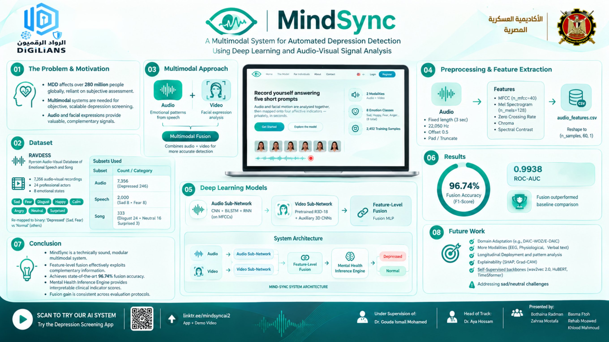

# MindSync — Multimodal Depression Screening via Audio-Video Emotion Recognition

Graduation team project. A deep learning pipeline that recognizes emotions from **speech audio** and **facial video**, fuses both, and maps the emotional profile onto rule-based mental-health indicators (e.g. a possible depression indicator).

> **My role:** improving the **video model** and its accuracy — hyperparameter search, re-fitting the best configurations and the video training pipeline.

## Results (RAVDESS, 8 emotions, 491-sample test split)

| Model | Architecture | Test Accuracy | Macro F1 | Reference paper |
|---|---|---|---|---|
| Audio | CNN + BiLSTM + SimpleRNN on log-Mel spectrograms | 85.55% | 85.51% | 79.24% |
| **Video** | **ResNet3D R3D-18 (Kinetics-400) + Conv3D head** | **96.54%** | **96.30%** | **92.72%** |
| Fusion | MLP on a 568-dim fused vector | 96.74% | 96.46% | 96.06% |

Reference: *"Emotion Unlocked: Multimodal Emotion Detection Through Audio-Video Fusion"*, Table VII.

## Pipeline

1. **Data** — RAVDESS speech + song, each audio clip paired with its video.
2. **Audio** — GPU log-Mel front-end, SpecAugment, CNN + BiLSTM + SimpleRNN.
3. **Video** — frames decoded once into a cache, GPU-side augmentation, fine-tuned R3D-18.
4. **Hyperparameter search** — grid search on a validation split; the top-3 video configs were re-trained at 25 epochs (best: learning rate 1e-4, batch size 8).
5. **Fusion** — `[MFCC(40) | audio probs(8) | R3D features(512) | video probs(8)]` → MLP (568 → 256 → 128 → 64 → 32 → 8).
6. **Mental Health Inference Engine** — rule-based layer on the fused emotion probabilities (e.g. high *sad* + low *happy* → possible depression indicator).
7. **End-to-end inference** — new video → audio extraction (ffmpeg) → all three models → indicators → report.

## Tech stack

Python · PyTorch · TensorFlow/Keras · torchvision (R3D-18) · librosa · OpenCV · scikit-learn · imbalanced-learn (SMOTE) · Kaggle GPU

## Run it

1. Open `MindSync_Multimodal_Emotion_Recognition.ipynb` on **Kaggle** with a GPU.
2. Add the RAVDESS dataset (the notebook can also download it via `kagglehub`).
3. Run all cells top to bottom. Section 9 (hyperparameter search) is optional via `RUN_TUNING`.

## Limitations

The notebook keeps the original experimental protocol so results stay comparable with the earlier run. As noted in its appendix, this protocol can **inflate** accuracy: scaling and SMOTE are applied before the train/test split, and the video checkpoint is selected on the test set. A stricter protocol (split first, select on validation only, speaker-independent splits) is the planned next step.

> ⚠️ The mental-health indicators are for research/screening demonstration only and are **not** a medical diagnosis.

## Team

Graduation project built by a team. This repository contains the notebook for the experiments I worked on.
